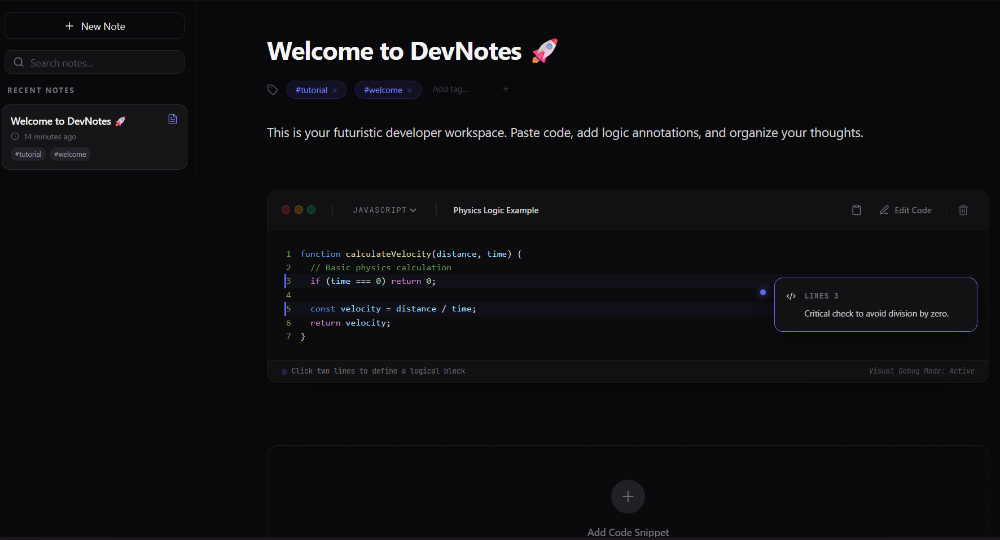
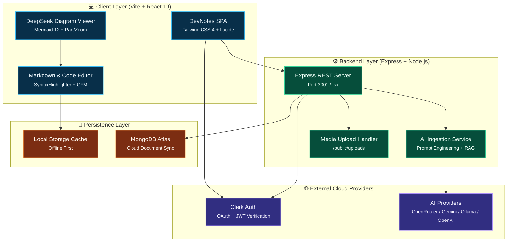

# ⚡ DevNotes — The Intelligent Developer Workspace & Architecture Studio

<p align="center">
  
</p>

<p align="center">
  <strong>An open-source, high-performance developer notebook, transcript processor, and software architecture studio.</strong><br />
  Transform raw transcripts, messy notes, and code into Staff-Engineer grade reference guides with interactive logic annotations and visual architecture schemas.
</p>

<p align="center">
  <a href="https://github.com/ahmadile/devnotes/blob/main/LICENSE"></a>
  <a href="https://react.dev/"></a>
  <a href="https://www.typescriptlang.org/"></a>
  <a href="https://vitejs.dev/"></a>
  <a href="https://tailwindcss.com/"></a>
  <a href="https://mermaid.js.org/"></a>
  <a href="https://clerk.com/"></a>
  <a href="https://www.mongodb.com/atlas"></a>
</p>

---

## 📑 Table of Contents

- [Overview](#-overview)
- [Key Features](#-key-features)
  - [1. AI Note & Transcript Ingestion](#1-ai-note--transcript-ingestion)
  - [2. DeepSeek + Claude Visual Diagram Viewer](#2-deepseek--claude-visual-diagram-viewer)
  - [3. Code Snippet Logic Annotations](#3-code-snippet-logic-annotations)
  - [4. Multi-Level Hierarchical Folders](#4-multi-level-hierarchical-folders)
  - [5. Architect Pro (RAG Engine)](#5-architect-pro-rag-engine)
  - [6. Resilient Media & Clipboard Paste](#6-resilient-media--clipboard-paste)
- [Architecture & Tech Stack](#-architecture--tech-stack)
- [Project Directory Structure](#-project-directory-structure)
- [Getting Started](#-getting-started)
  - [Prerequisites](#prerequisites)
  - [Installation & Setup](#installation--setup)
  - [Environment Variables](#environment-variables)
  - [Available Scripts](#available-scripts)
- [Supported AI Providers](#-supported-ai-providers)
- [Contributing](#-contributing)
- [Security](#-security)
- [License](#-license)

---

## 🌟 Overview

Developers consume countless hours of technical video courses, engineering documentation, and conference talks. Yet traditional note-taking tools are either **too simplistic** (unformatted text dumps) or **too complex** (clunky wikis that don't understand code semantics).

**DevNotes** is built specifically for software engineers, computer science students, and system architects. It bridges the gap between raw technical material and structured mental models:

1. **Ingest Anything**: Feed it video transcripts with timestamps, messy draft summaries, or raw code.
2. **Instant Synthesis**: Outputs clean, structured guides featuring real-world analogies, syntax references, micro-code blocks with commented outputs, and executable scripts.
3. **Interactive Diagrams**: Generates responsive vector flowcharts and architecture diagrams with interactive zoom, pan, fullscreen inspection, and SVG export.
4. **Code-Level Depth**: Annotates specific lines of code (`logic`, `important`, `warning`, `tip`, `debug`) to document complex inner workings.

---

## ✨ Key Features

### 1. AI Note & Transcript Ingestion
- **Transcript Cleaner**: Automatically strips spoken filler, conversational noise, and video timestamps (e.g., `00:00 - 01:23`).
- **Pedagogical Structure**: Formats notes with clear Problem Statements, Concept Definitions, Concrete Real-World Analogies, Key Takeaways, and Verification Steps.
- **Embedded Visual Schemas**: Generates visual diagrams directly from the input prompt, seamlessly integrated into the markdown content.
- **Executable Snippets**: Extracts complete, runnable code files with annotated line-by-line breakdowns.

### 2. DeepSeek + Claude Visual Diagram Viewer
Inspired by **DeepSeek's** sleek developer interface combined with **Claude's** semantic color hierarchy:
- **Interactive Controls**:
  - `[ Diagram ]` and `[ Code ]` tabs for instant switching between rendered SVG and raw Mermaid source.
  - Smooth Zoom (`+` / `-` / `100%` reset) and Drag-to-Pan navigation.
  - High-definition **SVG Vector Download** with one click.
  - **Fullscreen Modal** mode (`Escape` to close) for inspecting complex architectures without scrolling fatigue.
- **Claude Semantic Color Flow**:
  - 🔵 **Initial / Setup / Context**: Soft Sky / Cyan (`#082f49` / `#38bdf8`)
  - 🟢 **Processing / Actions**: Deep Emerald / Teal (`#064e3b` / `#34d399`)
  - 🟣 **Models / APIs / Responses**: Royal Indigo / Purple (`#312e81` / `#a78bfa`)
  - 🟡 **Decisions / Matrices**: Golden Amber (`#78350f` / `#fbbf24`)
  - 🟠 **Outputs / Metrics / Costs**: Terracotta / Peach (`#7c2d12` / `#fb923c`)
- **Auto-Responsive**: Scales smoothly to the reader's screen width (`width: 100%; height: auto`) without microscopic shrinkage or awkward cut-offs.

### 3. Code Snippet Logic Annotations
- Highlight any code line or line range to attach rich metadata.
- Tag annotations with semantic types:
  - `logic`: Explains algorithmic flow and state transitions.
  - `important`: Highlights critical invariants and constraints.
  - `warning`: Flags potential pitfalls, edge cases, and memory/performance bottlenecks.
  - `tip`: Captures developer best practices and conventions.
  - `debug`: Documents debugging techniques and log assertions.

### 4. Multi-Level Hierarchical Folders
- Infinite nested subfolder support with recursive parent/child management.
- **Visual Color Differentiation**:
  - **Root Folders**: Sleek Slate & Classic Blue icon.
  - **Level 1 Subfolders**: Emerald Green icon with vertical guide branch.
  - **Level 2 Subfolders**: Amethyst Purple icon with vertical guide branch.
  - **Level 3+ Subfolders**: Amber Gold icon with vertical guide branch.
- Inline creation, rename, move, and drag organization with zero layout shift.

### 5. Architect Pro (RAG Engine)
- Queries your local and cloud note library as a connected knowledge base.
- Generates comprehensive software architecture blueprints:
  - System component topology
  - Database schemas & relationships
  - REST/gRPC API endpoint specifications
  - Design pattern recommendations (Factory, Strategy, Event-Driven)

### 6. Resilient Media & Clipboard Paste
- **Direct Clipboard Paste**: Press `Ctrl+V` anywhere in the note editor to upload and insert images.
- **Smart Image Fallback**: Automatically uploads to backend storage (`/public/uploads`) while maintaining a resilient Base64 fallback if offline.
- **One-Click Image Removal**: Dedicated cleanup button on broken or unwanted image links.
- **Format Preservation**: Ensures clean aspect ratios (`object-contain`) without blowing up the layout.

---

## 🏗️ Architecture & Tech Stack



| Layer | Technologies |
| :--- | :--- |
| **Frontend** | React 19, TypeScript 5.8, Vite 6, Tailwind CSS 4, Framer Motion, Lucide React |
| **Diagrams & Markdown** | Mermaid.js 12, React Markdown, Rehype-Raw, Remark-GFM, Prism Syntax Highlighter |
| **Backend API** | Node.js, Express 4.21, TypeScript, Tsx watch, Helmet, CORS |
| **Authentication** | Clerk (`@clerk/clerk-react`, `@clerk/express`) |
| **Databases & Sync** | MongoDB Atlas, LocalStorage Debounced Cache, File System (`/public/uploads`) |
| **AI Integration** | Google GenAI SDK, OpenRouter REST API, Local Ollama REST API, OpenAI API |

---

## 📂 Project Directory Structure

```text
devnotes/
├── public/
│   └── uploads/              # Local uploaded image storage
├── server/
│   ├── aiService.ts          # Core AI prompt processing, RAG, and diagram generator
│   ├── db.ts                 # MongoDB connection and database helpers
│   ├── index.ts              # Express server routes, auth middleware, and API endpoints
│   └── tsconfig.json         # Backend TypeScript configuration
├── src/
│   ├── components/
│   │   ├── AiAssistantModal.tsx  # Note generator, AI chat, Architect Pro, and Settings
│   │   ├── CodeEditor.tsx        # Syntax-highlighted code editor with line annotations
│   │   ├── FloatingToolbar.tsx   # Contextual annotation and formatting toolbar
│   │   ├── Login.tsx             # Clerk sign-in / sign-up screens
│   │   ├── Logo.tsx              # Vector branded logo
│   │   ├── Markdown.tsx          # Rich markdown renderer, Mermaid viewer, and flow cards
│   │   ├── RevisionView.tsx      # Flashcard and interactive revision mode
│   │   └── Sidebar.tsx           # Multi-level colored folder tree and note search
│   ├── lib/
│   │   └── utils.ts              # Class name mergers (clsx/twMerge) and network fallbacks
│   ├── types.ts                  # Shared domain types (Note, Module, CodeSnippet, etc.)
│   ├── App.tsx                   # Main state orchestration and layout shell
│   ├── main.tsx                  # Client entrypoint and Clerk Provider wrapper
│   └── index.css                 # Global CSS and Tailwind directives
├── .env.example              # Sample environment configuration
├── DEPLOYMENT.md             # Production deployment guide (Vercel + Railway/Render)
├── package.json              # Project scripts and dependencies
├── tsconfig.json             # Frontend TypeScript configuration
└── vite.config.ts            # Vite bundler plugins, proxies, and aliases
```

---

## 🚀 Getting Started

### Prerequisites
- **Node.js**: v20.x or higher installed ([Download Node.js](https://nodejs.org/))
- **Package Manager**: npm (bundled with Node) or pnpm
- **Clerk Account**: Free account on [clerk.com](https://clerk.com) for authentication keys
- **MongoDB Atlas Cluster**: Free tier cluster on [mongodb.com](https://www.mongodb.com) (or local MongoDB)
- **AI API Key** *(Optional but recommended)*: [OpenRouter](https://openrouter.ai/) or [Google AI Studio](https://aistudio.google.com/)

### Installation & Setup

1. **Clone the repository:**
   ```bash
   git clone https://github.com/ahmadile/devnotes.git
   cd devnotes
   ```

2. **Install project dependencies:**
   ```bash
   npm install
   ```

3. **Configure Environment Variables:**
   Copy the `.env.example` template into `.env.local`:
   ```bash
   cp .env.example .env.local
   ```
   Edit `.env.local` with your credentials:
   ```env
   # Frontend Authentication (Clerk)
   VITE_CLERK_PUBLISHABLE_KEY=pk_test_...

   # Backend Authentication (Clerk)
   CLERK_PUBLISHABLE_KEY=pk_test_...
   CLERK_SECRET_KEY=sk_test_...

   # Database (MongoDB Atlas)
   MONGODB_URI=mongodb+srv://<username>:<password>@cluster.mongodb.net/?retryWrites=true&w=majority
   MONGODB_DB=devnotes

   # Backend Port (Defaults to 3001)
   PORT=3001
   API_URL=http://localhost:3001

   # AI Provider API Keys (Can also be configured directly in user settings)
   OPENROUTER_API_KEY=sk-or-v1-...
   GEMINI_API_KEY=AIzaSy...
   ```

4. **Start the Development Workspace:**
   This command concurrently boots both the Vite frontend (`localhost:5173`) and the Express API server (`localhost:3001`):
   ```bash
   npm run dev
   ```

5. **Open DevNotes in your browser:**
   Navigate to [http://localhost:5173](http://localhost:5173).

---

## 🤖 Supported AI Providers

DevNotes gives you complete freedom of AI infrastructure:

| Provider | Supported Models | Configuration | Privacy |
| :--- | :--- | :--- | :--- |
| **OpenRouter** | DeepSeek V3/R1, Claude 3.5 Sonnet, Gemini 2.0 Flash, Llama 3.3 | Set `OPENROUTER_API_KEY` or paste in Settings modal | Cloud |
| **Google Gemini** | Gemini 2.0 Flash, Gemini 1.5 Pro | Set `GEMINI_API_KEY` or paste in Settings modal | Cloud |
| **Ollama** | Llama 3, Mistral, Qwen 2.5, DeepSeek Coder, CodeLlama | Set `http://localhost:11434` in Settings modal | **100% Local / Offline** |
| **OpenAI** | GPT-4o, GPT-4o-mini, o3-mini | Set API Key in Settings modal | Cloud |

---

## 📜 Available Scripts

In the project directory, you can run:

- `npm run dev`: Starts both frontend and backend concurrently with hot-reloading.
- `npm run dev:web`: Starts only the Vite frontend dev server.
- `npm run dev:api`: Starts only the Express TypeScript backend via `tsx watch`.
- `npm run build`: Compiles both the Vite production client bundle (`/dist`) and the backend TypeScript files (`server/tsconfig.json`).
- `npm run preview`: Locally previews the compiled production build.
- `npm run lint`: Runs type-checking across frontend and backend configurations without emitting files.

---

## 🤝 Contributing

We welcome contributions from developers of all skill levels! Whether you want to add new language highlighters, improve diagram styling, optimize RAG embeddings, or translate UI strings, here is how you can help:

1. **Fork the Repository** on GitHub.
2. **Create a Feature Branch:**
   ```bash
   git checkout -b feature/amazing-feature
   ```
3. **Make your changes:**
   - Write clean, type-safe TypeScript code.
   - Follow the existing Tailwind CSS naming and component patterns.
4. **Test your build:**
   ```bash
   npm run build
   ```
5. **Commit your changes:**
   Use [Conventional Commits](https://www.conventionalcommits.org/) (e.g., `feat(diagrams): add dark theme contrast toggle`).
   ```bash
   git commit -m "feat(editor): add vim keybinding support"
   ```
6. **Push to your Branch:**
   ```bash
   git push origin feature/amazing-feature
   ```
7. **Open a Pull Request** describing your motivation, changes, and any relevant screenshots.

Please check [`CONTRIBUTING.md`](./CONTRIBUTING.md) for detailed code standards and workflow instructions.

---

## 🛡️ Security

DevNotes takes code privacy and security seriously:
- **Zero Ingestion of Private Code**: Your notes remain stored locally in your browser and your private MongoDB cluster.
- **Clerk Identity Verification**: All cloud synchronization endpoints verify signed JWTs via Clerk middleware.
- **Content Security Policy (CSP) & Helmet**: Express endpoints are guarded with HTTP headers preventing XSS, MIME-sniffing, and clickjacking.

If you discover a security vulnerability, please refer to [`SECURITY.md`](./SECURITY.md) to report it responsibly.

---

## 📄 License

This project is licensed under the **MIT License** — see the [LICENSE](LICENSE) file for details.

Developed with pride for the modern software engineering era.

<p align="center">
  <em>“Coding is an art. Your notes should be too.”</em> 🌌
</p>